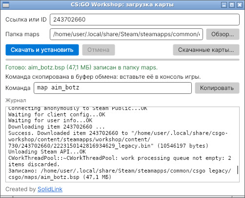
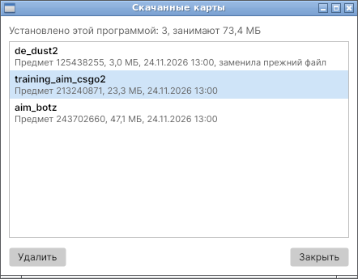
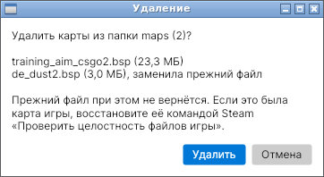

# CS:GO Workshop

Программа для Windows и Linux, которая устанавливает карты CS:GO Legacy из Steam Workshop. Вы вставляете ссылку на предмет или его ID, программа скачивает карту через steamcmd, кладёт `.bsp` в папку `maps` игры и показывает команду для консоли: `map название_карты`.

Установленные ею карты можно посмотреть, скопировать их консольную команду и удалить в окне «Скачанные карты».



## Возможности

- Принимает ссылку на предмет Workshop, числовой ID или путь вида `workshop/<ID>/...` (есть кнопка «Вставить» для вставки из буфера обмена).
- До запуска загрузки проверяет предмет в Steam Workshop: показывает название и размер архива, а также сразу предупреждает, если указана коллекция, предмет от другой игры или карта только для CS2.
- Показывает подробный прогресс на каждом этапе: подключение и вход в Steam, скачивание в реальном времени (скачанные мегабайты, скорость, проценты и прошедшее время) и распаковка `.bsp`.
- Сама скачивает steamcmd с серверов Valve (Windows и Linux), отдельно ничего ставить не нужно. Вход анонимный: аккаунт Steam не требуется, клиент Steam может быть закрыт.
- Распаковывает карту в папку `maps` и проверяет, что внутри настоящий файл карты Source (заголовок `VBSP`). Полностью очищает за собой временный кэш steamcmd и `ugc`.
- Показывает команду `map ...` и автоматически копирует её в буфер обмена.
- Запоминает путь к папке `maps`. При первом запуске пытается найти её сама: по реестру Steam на Windows, по стандартным папкам Steam на Linux (включая Flatpak и Snap) и по дополнительным библиотекам из `libraryfolders.vdf`. Защищает от случайного выбора папки карт CS2 (`.../game/csgo/maps`).
- Окно «Скачанные карты»: список карт, установленных программой, быстрое копирование команды `map ...` и удаление одной или нескольких карт.

## Установка

Готовые файлы лежат в разделе Releases:

| Система | Файл |
| --- | --- |
| Windows 10 / 11, x64 | `csgo-workshop-win-x64.exe` |
| Linux, x86-64 | `csgo-workshop-linux-x64` |

Установка не нужна. Это один самодостаточный файл, .NET отдельно ставить не требуется. Скачайте и запустите.

### Windows

Файл не подписан цифровой подписью, поэтому SmartScreen может показать предупреждение. Нажмите «Подробнее», затем «Выполнить в любом случае».

### Linux

Сделайте файл исполняемым и запустите:

```sh
chmod +x csgo-workshop-linux-x64
./csgo-workshop-linux-x64
```

Нужен графический сеанс с X11 или XWayland и библиотека fontconfig. На минимальных системах могут понадобиться пакеты `libx11-6`, `libice6`, `libsm6`, `libfontconfig1`.

steamcmd на Linux 32-битный, поэтому ему нужны 32-битные библиотеки:

```sh
# Debian, Ubuntu
sudo dpkg --add-architecture i386 && sudo apt update && sudo apt install lib32gcc-s1 lib32stdc++6

# Fedora
sudo dnf install glibc.i686 libstdc++.i686

# Arch (должен быть включён репозиторий multilib)
sudo pacman -S lib32-gcc-libs
```

Если их нет, программа сообщит, что не удалось запустить steamcmd, и покажет эти команды.

Кнопка «Обзор…» открывает выбор папки через zenity или kdialog (либо системный диалог через xdg-desktop-portal). Если ничего из этого нет, путь можно вписать в поле вручную.

## Использование

1. Откройте страницу предмета в Steam Workshop и скопируйте адрес из браузера, например `https://steamcommunity.com/sharedfiles/filedetails/?id=213240871`. Можно вставить только число после `id=`.
2. Нажмите «Вставить» (или вставьте адрес вручную в поле «Ссылка или ID»).
3. В поле «Папка maps» укажите `.../steamapps/common/csgo legacy/csgo/maps` (кнопка «Обзор…»). Можно указать и папку `csgo legacy` или `csgo`: программа найдёт `maps` внутри. Путь запоминается.
4. Нажмите «Скачать и установить». При самом первом запуске steamcmd обновляет сам себя (около 100 МБ), это занимает несколько минут и происходит один раз. «Отмена» прерывает загрузку.
5. Когда появится «Готово», команда уже скопирована в буфер обмена. Откройте консоль в игре (она включается в настройках игры, по умолчанию клавиша `~`) и вставьте её, например `map aim_botz`.

Что ещё полезно знать:

- Если в предмете несколько карт, установятся все, а команда будет дана для первой. Остальные перечислены под ней.
- Если файл с таким именем уже лежит в `maps`, он будет заменён, и программа об этом сообщит.
- Если в имени карты есть пробелы или необычные символы, имя в команде берётся в кавычки: `map "имя карты"`.
- Предметы только для CS2 (внутри `.vpk`) не поддерживаются — программа предупредит об этом сразу при проверке предмета.

## Скачанные карты

Кнопка «Скачанные карты…» открывает список карт, которые установила программа: имя, ID предмета, размер, дата установки.



- Щелчок по строке выделяет её, повторный щелчок снимает выделение, Shift и щелчок выделяют диапазон.
- Кнопка «Копировать команду» (или `Ctrl+C`) копирует команду `map ...` выбранной карты в буфер обмена.
- Кнопка «Удалить» (или клавиша Delete) спрашивает подтверждение и удаляет файлы `.bsp` из папки `maps`. В окне подтверждения Enter соглашается, Esc отменяет.
- Удаляются только те файлы, которые записала программа. Остальные карты в `maps`, в том числе родные карты игры, в списке не появляются и не затрагиваются.
- Пометка «заменила прежний файл» значит, что при установке был перезаписан уже существовавший файл (например, `de_dust2.bsp` из самой игры). Удаление его не вернёт. Чтобы восстановить, выполните в Steam «Проверить целостность файлов игры». Перед удалением программа напоминает об этом.
- Пометка «файла нет в папке maps» появляется, если файл удалён вручную. Такую запись можно убрать из списка той же кнопкой «Удалить».
- Карты, установленные версиями до 1.1, в списке не появятся: тогда программа не вела записей. Их можно удалить из папки `maps` вручную.



## Где хранятся данные

| | Windows | Linux |
| --- | --- | --- |
| Настройки (`config.json`) и список скачанных карт (`installed.json`) | `%APPDATA%\CsgoWorkshop` | `~/.config/csgo-workshop` |
| steamcmd и временные файлы | `%LOCALAPPDATA%\CsgoWorkshop` | `~/.local/share/csgo-workshop` |
| Распакованные библиотеки (файл запускается как один exe) | `%TEMP%\.net` | `~/.net` |

На Linux учитываются `XDG_CONFIG_HOME` и `XDG_DATA_HOME`. Если путь к `%LOCALAPPDATA%` содержит не ASCII-символы (например, кириллицу в имени пользователя), steamcmd кладётся в `%ProgramData%\CsgoWorkshop` или `C:\Users\Public\CsgoWorkshop`: steamcmd.exe с такими путями не работает.

Чтобы полностью удалить программу, удалите эти папки и сам файл. Карты в `maps` при этом остаются.

## Сборка из исходников

Нужен [.NET 10 SDK](https://dotnet.microsoft.com/download).

```sh
dotnet run --project src/App     # запуск из исходников
dotnet test                      # тесты
./build.sh                       # тесты и сборка обоих релизных файлов в release/
./build.sh --skip-tests          # то же без тестов
```

`build.sh` написан на bash (Linux, macOS, Git Bash на Windows). Он собирает оба файла, и для Windows, и для Linux, на любой из этих систем.

Без bash один файл собирается командой `dotnet publish`:

```sh
dotnet publish src/App/App.csproj -c Release -r win-x64 --self-contained true -p:PublishSingleFile=true -p:IncludeNativeLibrariesForSelfExtract=true -p:EnableCompressionInSingleFile=true -o release/win-x64
```

Для Linux замените `win-x64` на `linux-x64`. Результат: `release/win-x64/csgo-workshop.exe` и `release/linux-x64/csgo-workshop`.

## Тесты

`dotnet test` запускает модульные тесты (разбор ссылок, метаданные Workshop, имена карт, распаковка, список скачанных карт, разбор вывода и прогресса steamcmd). Сеть для них не нужна.

Ещё три теста скачивают реальные предметы из Workshop и по умолчанию пропускаются. Чтобы включить их, задайте переменную `CSGO_WS_ONLINE=1`. Переменная `CSGO_WS_IT_DIR` указывает папку, в которой между запусками сохраняется установленный steamcmd.

## Структура проекта

```
src/Core/          логика без интерфейса: разбор ссылки, метаданные Workshop, steamcmd, распаковка, список карт, настройки
src/App/           окна на Avalonia: главное, «Скачанные карты», подтверждение
tests/Core.Tests/  модульные и сетевые тесты
build.sh           сборка релизных файлов
docs/screenshots/  скриншоты для этого файла
```

C#, .NET 10, Avalonia 11 (тема Fluent, светлая), программный рендеринг без GPU.

## Как это работает

1. Запрашивает публичную информацию о предмете через `ISteamRemoteStorage/GetPublishedFileDetails` (название, размер архива, принадлежность к CS:GO Legacy).
2. Скачивает steamcmd (`steamcmd.zip` или `steamcmd_linux.tar.gz` с серверов Valve) в папку данных и один раз запускает его для самообновления.
3. Скачивает предмет командой:
   ```
   steamcmd +@ShutdownOnFailedCommand 1 +@NoPromptForPassword 1 +force_install_dir <папка> +login anonymous +workshop_download_item 730 <ID> +quit
   ```
   отслеживая этапы работы и объём скачанных данных на диске в реальном времени.
4. Для карт CS:GO в результате получается файл `<число>_legacy.bin`. Это обычный ZIP с `.bsp` внутри. Программа читает `.bsp`, проверяет заголовок `VBSP`, пишет во временный файл `.part` и переименовывает его в `<имя>.bsp` в папке `maps`.
5. Очищает кэш steamcmd (включая `userdata/anonymous/ugc`) и записывает карту в `installed.json`.

Имя карты берётся из имени `.bsp` внутри архива. До того как оно попадёт в команду для консоли, оно проверяется: символы вроде `;`, кавычек и перевода строки не допускаются.

## Ограничения

- Только CS:GO Legacy. Предметы для CS2 не скачиваются.
- Скрытые предметы и предметы только для друзей анонимным входом не скачать.
- Список «Скачанные карты» ведётся только для установок, сделанных начиная с версии 1.1.
